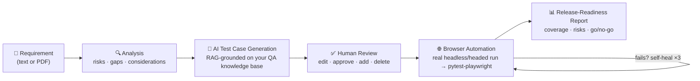

<div align="center">

# 🤖 AI QA Copilot

**An AI QA engineer for your app.**
Submit a requirement → get a risk analysis, AI-generated test cases, real browser automation, and a release-readiness report.

[](#backend)
[](#frontend)
[](#backend)
[](#-features)
[](#-swappable-llm-provider)
[](https://github.com/Adnaan1806/AI-QA-Copilot/issues)
[](https://github.com/Adnaan1806/AI-QA-Copilot/commits/main)

[Features](#-features) · [How it works](#-how-it-works) · [Quick start](#-quick-start) · [Docs](#-docs)

</div>

---

## ✨ What is this?

Writing test cases, wiring up automation, and deciding whether a release is safe to ship all take real QA time. **AI QA Copilot** takes a requirement (plain text or a PDF) and carries it all the way to a release decision — with a human approval checkpoint in the middle, so nothing gets automated without your sign-off.

## 🚀 How it works



Every approved test case gets its own real browser session to *ground* working locators before a script is written — so the generated `pytest-playwright` code reflects the app as it actually behaves, not a guess. Test cases run concurrently, and a failing script gets up to three self-healing attempts using its own pytest failure output.

## 🧩 Features

| | |
|---|---|
| 🔍 **Requirement analysis** | Submit a requirement (text or PDF) and get back structured requirements, risks, missing information, and testing considerations. |
| 🧪 **AI-generated test cases** | Functional, negative, edge-case, and security cases — grounded via RAG against a QA knowledge base you upload (past test cases, bug reports, business rules). |
| ✅ **Human review** | Edit, approve, add, or delete test cases before anything gets automated. Nothing runs without your go-ahead. |
| 🌐 **Real browser automation** | Each approved test case drives a real browser step by step to ground actual working locators, then turns them into a `pytest-playwright` script. Concurrent, not sequential. |
| 🔁 **Self-healing scripts** | Failing scripts repair themselves using real pytest failure output, up to 3 attempts. |
| 🎯 **Targeted reruns** | Rerun automation for a single test case (e.g. one flagged "needs review") without regenerating everything else. |
| 📊 **Release-readiness report** | A summary, coverage analysis, quality risks, and a release recommendation — grounded in exact test/automation counts, not vibes. |
| 🔄 **Swappable LLM provider** | Gemini by default (pay-per-token API key), or Claude via a locally logged-in `claude` CLI, riding your Claude Code subscription instead of a separate API key. Toggle with `LLM_PROVIDER` in `.env`. |

## 🛠️ Quick start

### Backend

```bash
cd backend
python3 -m venv .venv
source .venv/bin/activate
pip install -r requirements.txt
cp .env.example .env   # fill in GEMINI_API_KEY and DATABASE_URL (or set LLM_PROVIDER=claude)
uvicorn app.main:app --reload
```

Requires a running PostgreSQL instance matching `DATABASE_URL` in `.env`. Tables are created automatically on startup.

> ⚠️ `.env` is only read once, at process start. After changing it, restart the backend — `--reload` watches `.py` files, not `.env`.

API docs live at **http://localhost:8000/docs**

### Frontend

```bash
cd frontend
npm install
npm run dev
```

Runs at **http://localhost:5173**, expects the backend at `http://localhost:8000`.

## 🔄 Swappable LLM provider

| Provider | How it's billed | Setup |
|---|---|---|
| **Gemini** (default) | Pay-per-token API key | Set `GEMINI_API_KEY` in `.env` |
| **Claude** | Rides your Claude Code subscription | Log in to the `claude` CLI locally, set `LLM_PROVIDER=claude` in `.env` |

## 📚 Docs

- [`TEST_GENERATION_APPROACH.md`](https://github.com/Adnaan1806/AI-QA-Copilot/blob/main/TEST_GENERATION_APPROACH.md) — how the generation pipeline actually works under the hood
- [`AI-QA-COPILOT-ROADMAP.md`](https://github.com/Adnaan1806/AI-QA-Copilot/blob/main/AI-QA-COPILOT-ROADMAP.md) — the original vision, and what's still ahead

---

<div align="center">

Built by [Adnaan Janees](https://github.com/Adnaan1806)

</div>
