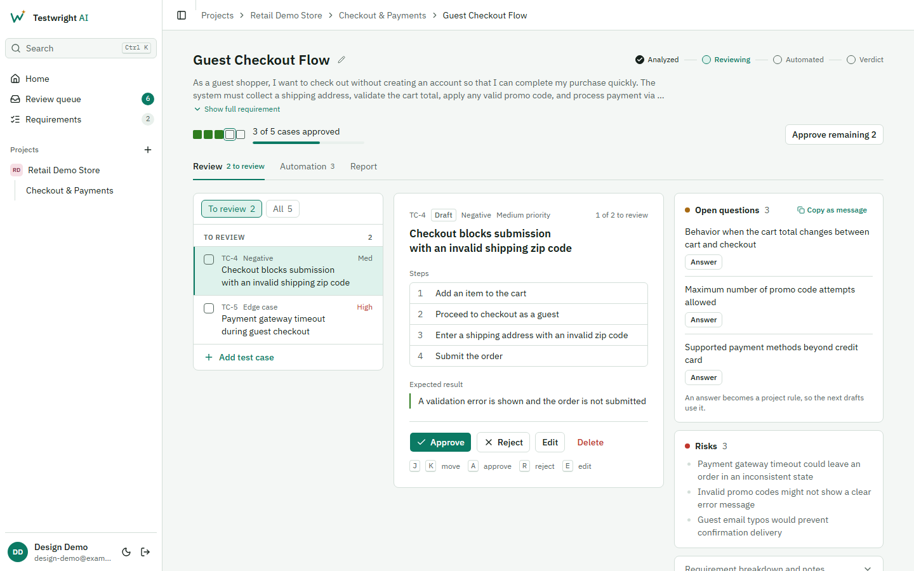
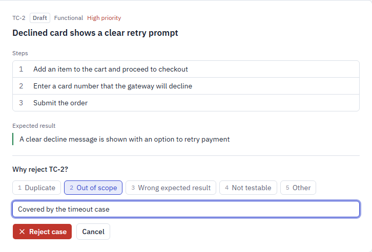
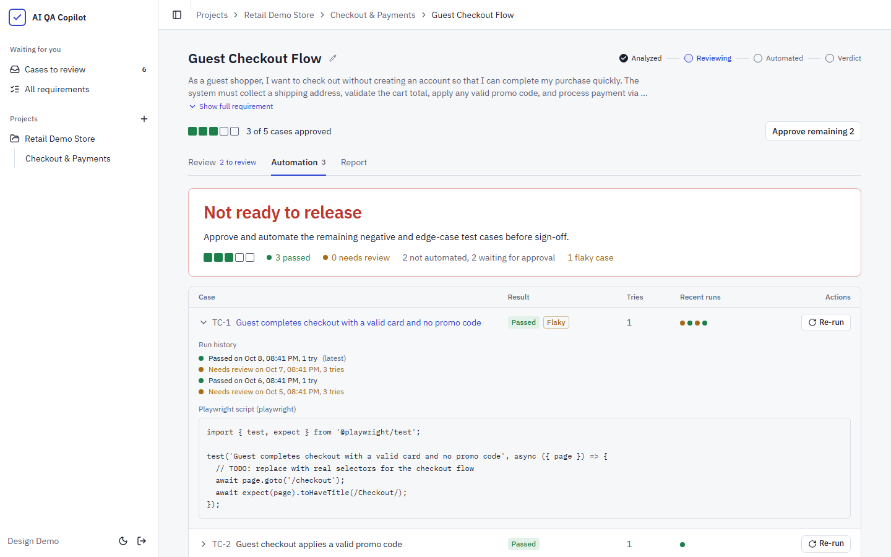
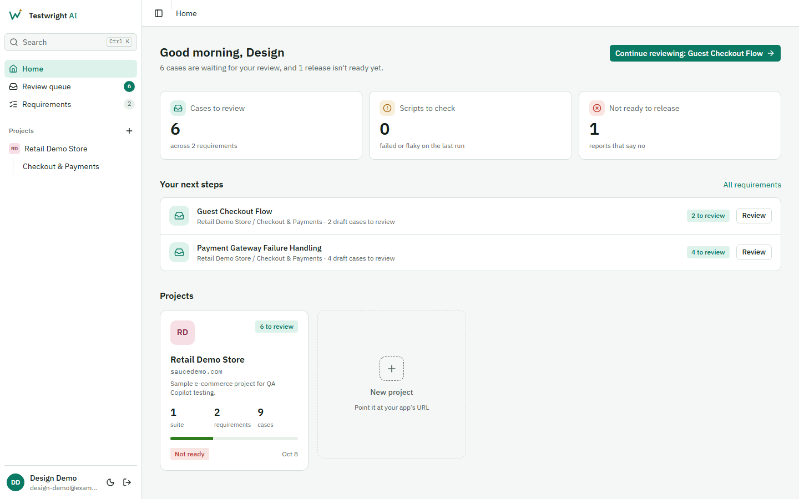
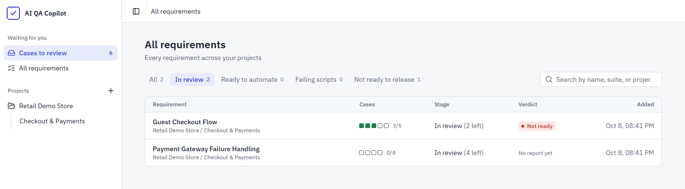
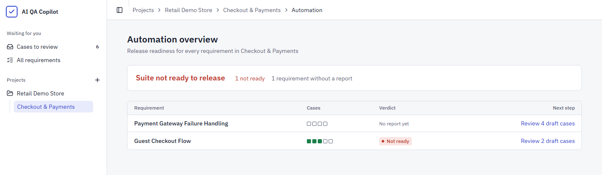
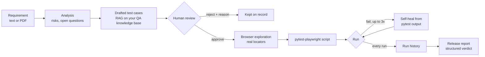
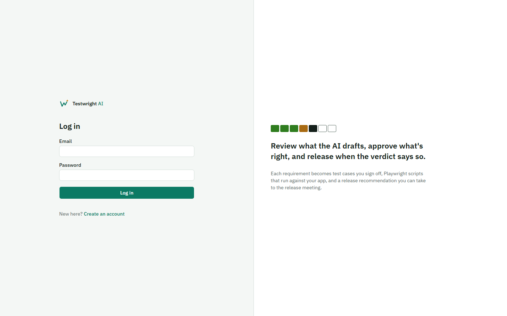

<div align="center">

# Testwright AI

**Paste a requirement. Review what the AI drafts. Ship when the verdict says so.**

Testwright AI turns a user story into reviewed test cases, real Playwright automation,<br/>and a release call you can take to the go/no-go meeting.

[](#-run-it-locally)
[](#-run-it-locally)
[](#-run-it-locally)
[](#3-automate-what-you-approved)
[](#-pick-your-model)


[The workflow](#-from-requirement-to-release-call) · [Features](#-everything-it-does) · [Under the hood](#-under-the-hood) · [Run it locally](#-run-it-locally)

<br/>

<picture>
  <source media="(prefers-color-scheme: dark)" srcset="docs/screenshots/review-dark.png">
  
</picture>

<sub>Screenshots follow your GitHub theme. Switch between light and dark to see the other one.</sub>

</div>

---

## 🟩🟩🟩⬜⬜ Read a requirement in one glance

Every requirement carries a **case strip**: one square per test case, coloured by where that case stands. It's on every list, header and report, so you can see what's covered (and what isn't) before reading a single number.

| Square | Means |
|:---:|---|
| ⬜ | **Draft.** Written by the AI, nobody has reviewed it yet |
| ⬛ | **Approved.** Signed off by a person, waiting for automation |
| 🟩 | **Passed.** Its Playwright script ran green |
| 🟧 | **Needs review.** The script still fails after three self-healing attempts |
| ✖️ | **Rejected.** Kept on record with a reason, never run |

The strip never hides the gaps. A requirement with three passing cases and two unreviewed ones reads as `🟩🟩🟩⬜⬜`, not "100% passed".

## 🧭 From requirement to release call

### 1. Write it down

Paste a user story or acceptance criteria into a suite, or upload a PDF. Testwright reads it, pulls related context from the project's knowledge base, and drafts test cases: functional, negative, edge case and security. It also lists **open questions for the product owner** and **risks**, and one click copies the questions as a ready-to-send message.

### 2. Review the drafts

Nothing gets automated without a person signing it off. Work down the list with the keyboard: approve with <kbd>A</kbd>, reject with <kbd>R</kbd>, and the next draft opens automatically.

Rejecting asks why, so you keep a record of where the drafts go wrong:

<picture>
  <source media="(prefers-color-scheme: dark)" srcset="docs/screenshots/reject-dark.png">
  
</picture>

Every approval and rejection records **who** made it and **when**. Editing an approved case warns you first, because the change sends it back to draft.

### 3. Automate what you approved

Once every case is approved or rejected, generate automation. For each approved case Testwright:

1. drives a **real browser** through the steps to find locators that actually work,
2. writes a `pytest-playwright` script from what it saw,
3. runs it, and if it fails, **heals it** using the real failure output, up to three times.

Cases run concurrently, and you can watch each one's progress live. Every run is kept, so a case that passes one day and fails the next gets flagged **Flaky**.

### 4. Make the call

The release verdict comes first, in its own colour. Below it is every case: the ones that passed, the ones that need review (with *why* they failed shown above the script), and the ones that never got automated.

<picture>
  <source media="(prefers-color-scheme: dark)" srcset="docs/screenshots/verdict-dark.png">
  
</picture>

The report agent returns a structured verdict (**Ready**, **Ready with risks** or **Not ready**) with a summary, coverage analysis and quality risks, grounded in exact case counts.

## 🗂️ Stay on top of everything

The sidebar keeps a **Review queue** with a live count, plus **Failing scripts** when any exist, and **Ctrl K** search jumps to any project, suite or requirement. Home opens with what's waiting for you: summary tiles, **your next steps** with a button to act on each, and every project as a card:

<picture>
  <source media="(prefers-color-scheme: dark)" srcset="docs/screenshots/projects-dark.png">
  
</picture>

<table>
<tr>
<td width="50%" valign="top">

**All requirements**, filterable by stage: in review, ready to automate, failing scripts, or not ready to release.

<picture>
  <source media="(prefers-color-scheme: dark)" srcset="docs/screenshots/all-requirements-dark.png">
  
</picture>

</td>
<td width="50%" valign="top">

**Suite release readiness**: one line answering "can this suite ship?", with the next step for every requirement.

<picture>
  <source media="(prefers-color-scheme: dark)" srcset="docs/screenshots/suite-overview-dark.png">
  
</picture>

</td>
</tr>
</table>

### ⌨️ Review at keyboard speed

| Key | Does |
|:---:|---|
| <kbd>J</kbd> / <kbd>K</kbd> | Next / previous case |
| <kbd>A</kbd> | Approve, then open the next draft |
| <kbd>R</kbd> | Reject (then <kbd>1</kbd>–<kbd>5</kbd> to pick a reason, <kbd>Enter</kbd> to confirm) |
| <kbd>E</kbd> | Edit the case |
| <kbd>Esc</kbd> | Cancel an edit or rejection |

## ✨ Everything it does

| | |
|---|---|
| 🔍 **Requirement analysis** | Structured requirements, risks, missing information and testing notes from plain text or a PDF. |
| 🧪 **Grounded test cases** | Functional, negative, edge-case and security cases, grounded via RAG on the project's own knowledge base (business rules, user guides, past stories) that you add on the project's **Knowledge** tab. Other projects never see it. |
| 🗺️ **App map** | When a project gets its app URL, a crawler (plain code, no LLM) follows the app's links with a hidden browser and records each page's headings, buttons, fields and messages. Same site only, robots.txt respected, never clicks buttons or submits forms. Shown on the project's **Knowledge** tab, with page and depth limits and start paths you can set. |
| ✅ **Human sign-off** | Approve, reject with a reason, edit, add or delete. Each decision records who made it and when. Excel export of the approved set. |
| 🌐 **Real browser automation** | Each case drives a real browser to ground its locators before a `pytest-playwright` script is written. Concurrent, with live progress. |
| 🔁 **Self-healing scripts** | Failing scripts repair themselves from real pytest output, up to three attempts. Re-run a single case without regenerating the rest. Download its Playwright trace. |
| 📈 **Run history** | Every run is kept. Cases whose recent runs both passed and failed are flagged **Flaky**. |
| 📊 **Release verdict** | Ready, ready with risks, or not ready, with summary, coverage and quality risks. Rolled up per suite. |
| 🌗 **Light and dark** | Full dark mode, and the layout works down to phone width. |
| 🔄 **Swappable LLM** | Gemini by API key, or Claude through your logged-in `claude` CLI. |

## 🔧 Under the hood



| Layer | Stack |
|---|---|
| Frontend | React 19, Vite, Tailwind CSS v4, shadcn/ui, IBM Plex |
| Backend | FastAPI, SQLAlchemy, PostgreSQL |
| AI | Gemini or Claude, LangGraph orchestration, Chroma for RAG |
| Automation | Playwright (exploration and execution), pytest-playwright |

## 🛠️ Run it locally

You'll need Python 3.12+, Node 20+, and a running PostgreSQL instance.

**Backend**

```bash
cd backend
python3 -m venv .venv
source .venv/bin/activate        # Windows: .venv\Scripts\activate
pip install -r requirements.txt
playwright install chromium
cp .env.example .env             # fill in DATABASE_URL and GEMINI_API_KEY (or set LLM_PROVIDER=claude)
uvicorn app.main:app --reload
```

Tables are created on first start. API docs live at **http://localhost:8000/docs**.

> [!NOTE]
> `.env` is read once at startup. After changing it, restart the backend: `--reload` watches `.py` files, not `.env`.

**Frontend**

```bash
cd frontend
npm install
npm run dev
```

Opens at **http://localhost:5173** and expects the backend at `http://localhost:8000` (override with `VITE_API_BASE_URL`).

<details>
<summary><b>Upgrading an existing database</b></summary>

New tables are created automatically, but new columns on existing tables are not. If your database predates a feature, run the matching migration from `backend/` (each is safe to re-run):

```bash
PYTHONPATH=. python scripts/migrate_automation_v2.py   # project base URL, script status and attempts
PYTHONPATH=. python scripts/migrate_trace_path.py      # Playwright trace downloads
PYTHONPATH=. python scripts/migrate_review_audit.py    # reviewer, reject reasons, run history, verdicts
PYTHONPATH=. python scripts/migrate_run_tries.py       # code and output of every try, for the try history
PYTHONPATH=. python scripts/migrate_report_statuses.py # case statuses each report was written for
PYTHONPATH=. python scripts/migrate_case_coverage.py   # criterion each case covers, suggested cases
PYTHONPATH=. python scripts/migrate_knowledge_kind.py   # tag older knowledge chunks as documents
PYTHONPATH=. python scripts/migrate_case_start.py       # whether each case starts logged in, and as which account
PYTHONPATH=. python scripts/migrate_app_knowledge.py    # assumptions and open questions from drafting with the app map
PYTHONPATH=. python scripts/migrate_flows.py            # merge workflows learned per test case into shared flows
PYTHONPATH=. python scripts/migrate_case_questions.py   # which open questions each case depends on
PYTHONPATH=. python scripts/migrate_question_answers.py # which open questions were answered or dismissed
```

</details>

<details>
<summary><b>Tests and benchmark</b></summary>

From `backend/`:

```bash
python -m pytest tests                                                          # unit tests, no LLM or browser
PYTHONPATH=. python scripts/benchmark.py --project "<name>" --mode approved --label baseline
PYTHONPATH=. python scripts/benchmark.py --compare benchmarks/<before>.json benchmarks/<after>.json
```

The benchmark runs the real agents on a project's requirements without saving anything: `approved` automates the approved cases from scratch, `fresh` also generates new cases first. It records pass rate, tries, how often healing gave up, and how many steps the Explorer couldn't match on the page, into `backend/benchmarks/`.

</details>

## 🤖 Pick your model

| Provider | Billing | Setup |
|---|---|---|
| **Gemini** (default) | Pay per token | Set `GEMINI_API_KEY` in `.env` |
| **Claude** | Uses your Claude Code subscription | Log in to the `claude` CLI, then set `LLM_PROVIDER=claude` in `.env` |

## 📚 More

- [`AI-QA-COPILOT-ROADMAP.md`](AI-QA-COPILOT-ROADMAP.md): the original vision and what's still ahead
- [`frontend/README.md`](frontend/README.md): frontend layout and design tokens

---

<div align="center">

<picture>
  <source media="(prefers-color-scheme: dark)" srcset="docs/screenshots/login-dark.png">
  
</picture>

Built by [Adnaan Janees](https://github.com/Adnaan1806)

</div>
